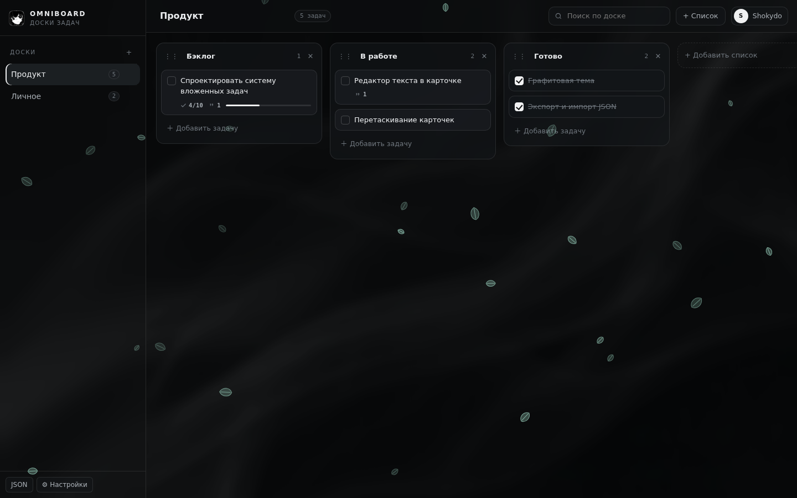
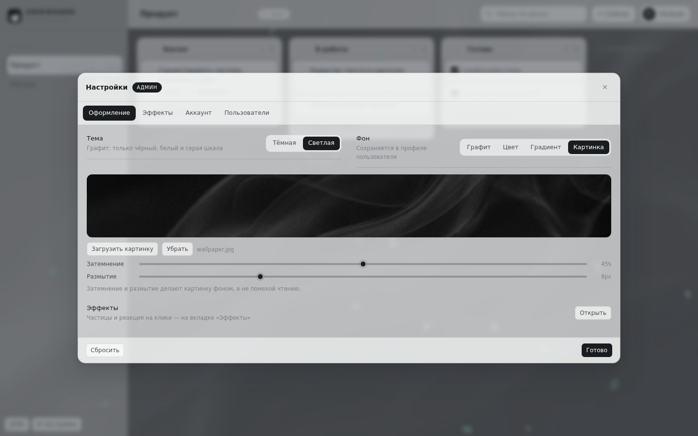
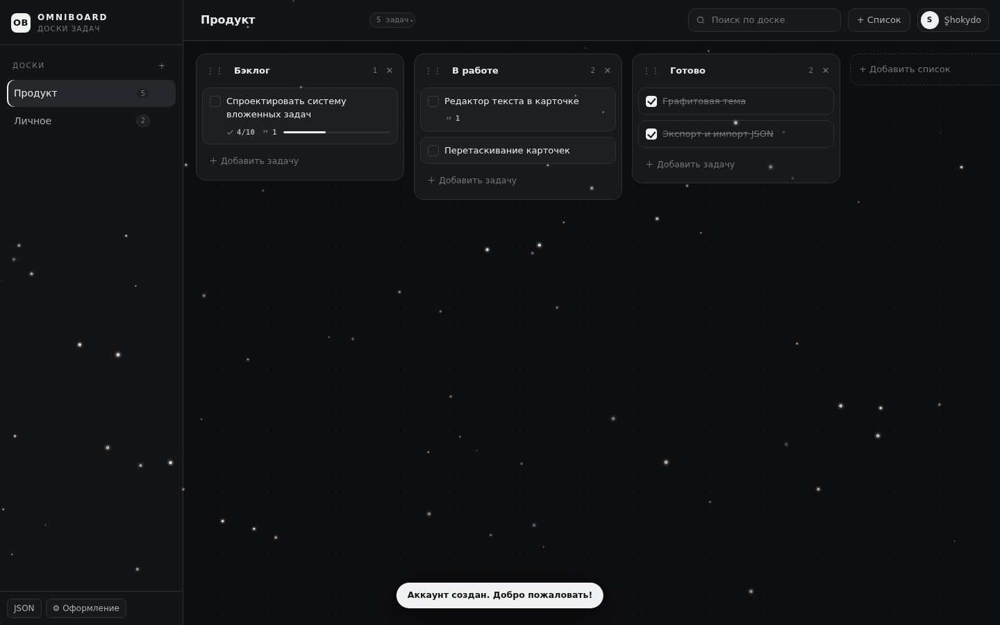

# OmniBoard

Канбан-доски для технических задач в одном HTML-файле: аккаунты, доски как в Trello, задачи любой вложенности, редактор текста, изображения, примеры, падающий снег и настраиваемый фон. Без сервера, сборки и зависимостей.

**[Открыть демо](https://shokydo.github.io/OmniBoard/)** · вход в аккаунт `Shokydo`, пароль по умолчанию `omniboard` (смените его в настройках аккаунта). Всё хранится в вашем браузере.



## Возможности

### Аккаунты и авторизация
- Только вход по логину и паролю, «запомнить меня» на устройстве — публичной регистрации нет.
- **Роли:** `администратор` и `пользователь`. Администратор создаёт аккаунты прямо в настройках, задаёт и сбрасывает пароли (без знания старого), выдаёт и снимает права, удаляет пользователей вместе с их данными. Себя удалить нельзя, последнего администратора нельзя разжаловать.
- Аккаунт `Shokydo` создаётся автоматически при первом открытии страницы; пароль по умолчанию — `omniboard`, в интерфейсе об этом есть напоминание, пока пароль не сменён.
- Пароль хранится как **PBKDF2-SHA256** (12 000 итераций, случайная соль 16 байт) — реализация без внешних библиотек, совпадает с эталоном WebCrypto.
- В настройках аккаунта: смена имени, смена пароля (с проверкой текущего и снятием флага «пароль по умолчанию»), выход, сброс данных аккаунта.
- Данные **изолированы по пользователю**: у каждого свои доски, задачи и оформление.
- Всё локально: аккаунты и доски лежат в `localStorage` браузера. Забытый пароль восстановить нельзя — для переноса есть экспорт JSON.

> Честное предупреждение: это клиентская авторизация для локального приложения. Она защищает от случайного доступа и разделяет профили, но не заменяет серверную аутентификацию — любой, у кого есть доступ к браузеру и devtools, может прочитать данные.

### Доски и задачи
- Несколько досок, колонки: создание, переименование, удаление, перестановка за ручку `⋮⋮`.
- Карточки перетаскиваются между колонками и внутри колонки (pointer-события, живой «призрак», подсветка места вставки, поддержка тач-устройств по долгому нажатию).
- Поиск по доске (`Ctrl/Cmd+K`).
- Вложенность без ограничения: **задача → подзадача → подзадача → …**, прогресс по всему поддереву, хлебные крошки, открытие подзадачи отдельной карточкой.
- Клавиатура по дереву: `Enter` — подзадача рядом, `Tab` — вложить, `Shift+Tab` — вынести выше, `Backspace` в пустом названии — удалить.
- Чекбоксы на карточках и на любом узле дерева.
- Редактор текста: B/I/U/S, H2/H3, списки, цитата, блок кода, ссылка, разделитель, картинка в тексте, вставка из буфера `Ctrl+V`.
- Изображения: файлами, перетаскиванием или из буфера; галерея с просмотром на весь экран.
- Примеры: блоки «заметка / код» с названием и текстом, счётчики на карточке.
- Экспорт/импорт JSON (включая настройки оформления), автосохранение.

### Оформление (сохраняется в профиле пользователя)
- Тема: тёмная графитовая и светлая, только чёрный/белый/серая шкала.
- Фон: **графит**, **цвет**, **градиент** (два цвета + наклон) или **картинка**.
- Для картинки: загрузка файлом или перетаскиванием, **затемнение 0–90 %** и **размытие 0–30 px**; панели интерфейса становятся «стеклянными» (`backdrop-filter`), чтобы фото читалось как фон, а не мешало.
- Падающий снег: включение и три уровня интенсивности, мягкие снежинки на `<canvas>`, пауза в неактивной вкладке, уважает `prefers-reduced-motion`.
- Настройки хранятся отдельно для каждого аккаунта: `omniboard.prefs.<id>`.

<table>
<tr>
<td></td>
<td></td>
</tr>
<tr>
<td></td>
<td></td>
</tr>
<tr>
<td></td>
<td></td>
</tr>
</table>

## Как запустить

**Просто открыть файл.** Скачайте `index.html` и откройте в браузере — работает офлайн, данные сохраняются в браузере.

**Локальный сервер** (если нужен «настоящий» origin для хранилища):

```bash
python3 -m http.server 8080
# затем http://localhost:8080/
```

**GitHub Pages.** Репозиторий уже настроен: Settings → Pages → Source: `main` / root. Страница будет по адресу `https://<username>.github.io/OmniBoard/`.

## Горячие клавиши

| Клавиши | Действие |
| --- | --- |
| `Enter` | новая подзадача рядом (в поле названия подзадачи) |
| `Tab` / `Shift+Tab` | вложить / вынести подзадачу |
| `Ctrl/Cmd+K` | поиск по доске |
| `Esc` | закрыть окно, панель или диалог |
| `Ctrl+V` | вставить изображение в текст |

## Структура

```
index.html      — всё приложение: разметка, стили, логика (~150 КБ, без зависимостей)
assets/         — иконка (icon-512.png, favicon.ico, avatar-128.png) и графитовые обои
                  для демонстрации фона
screenshots/    — скриншоты для README
```

Ключи в `localStorage`:

| Ключ | Что хранит |
| --- | --- |
| `omniboard.auth.v1` | аккаунты: логин, имя, роль, соль, PBKDF2-хеш, параметры |
| `omniboard.session.v1` | активная сессия («запомнить меня» → localStorage, иначе sessionStorage) |
| `omniboard.data.<id>` | доски, колонки, задачи, подзадачи, изображения, примеры |
| `omniboard.prefs.<id>` | тема, фон, затемнение, размытие, снег |

## Технически

Один файл, ES5-совместимый JS без сборки и зависимостей. Модель — плоский словарь задач со ссылками `parentId` / `subtasks[]` плюс порядок карточек в колонках. Хеширование — собственная реализация SHA-256/HMAC/PBKDF2 (проверена на векторах NIST и сверена с `crypto.subtle`). Снег — `requestAnimationFrame` + `<canvas>` с DPR-масштабированием. Перетаскивание — pointer-события вместо HTML5 DnD: работает стабильнее и поддерживает тач.

Иконка: рисунок сжат в квадрат 512×512, из него собраны `assets/favicon.ico` (16–256 px) и PNG-наборы; в `index.html` favicon и логотип встроены как `data:`-URI, поэтому один файл остаётся самодостаточным.

Проверено автотестами на Chromium и jsdom (59 шагов в четырёх наборах): отсутствие регистрации в интерфейсе, вход с паролем по умолчанию, неверный пароль, смена пароля и имени, сброс данных аккаунта, создание пользователей администратором, изоляция данных, сброс чужого пароля, выдача и снятие прав, удаление пользователя, сохранение сессии, режимы фона, затемнение/размытие, снег, вложенность задач, форматирование, изображения, drag & drop.
