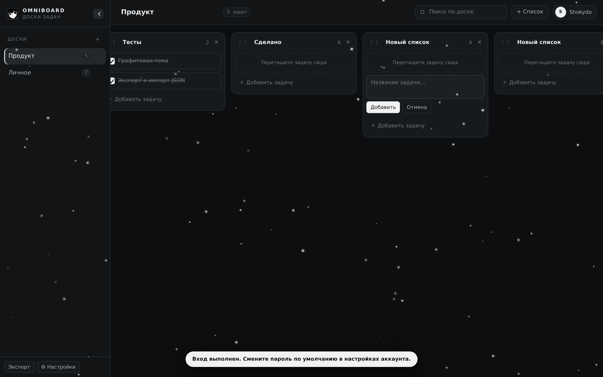
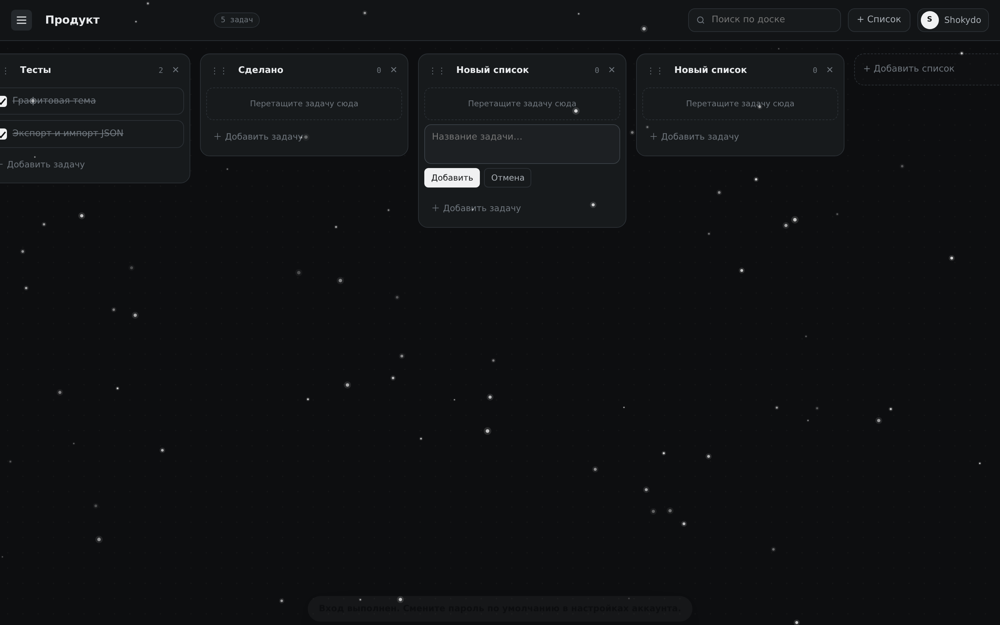
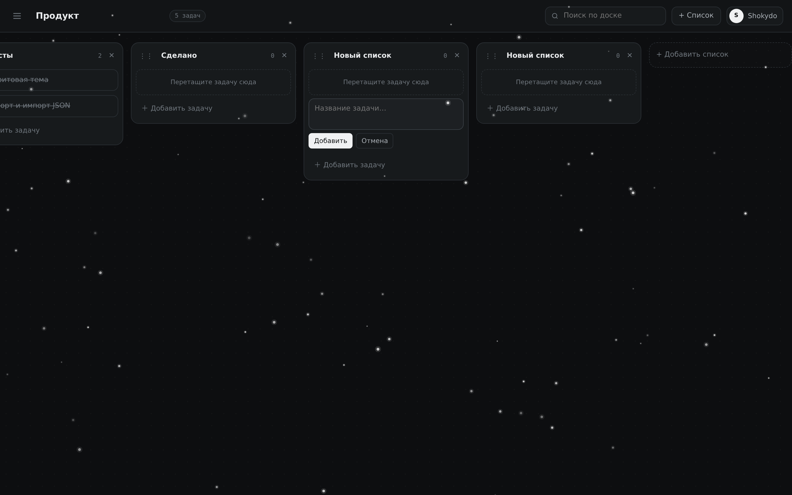
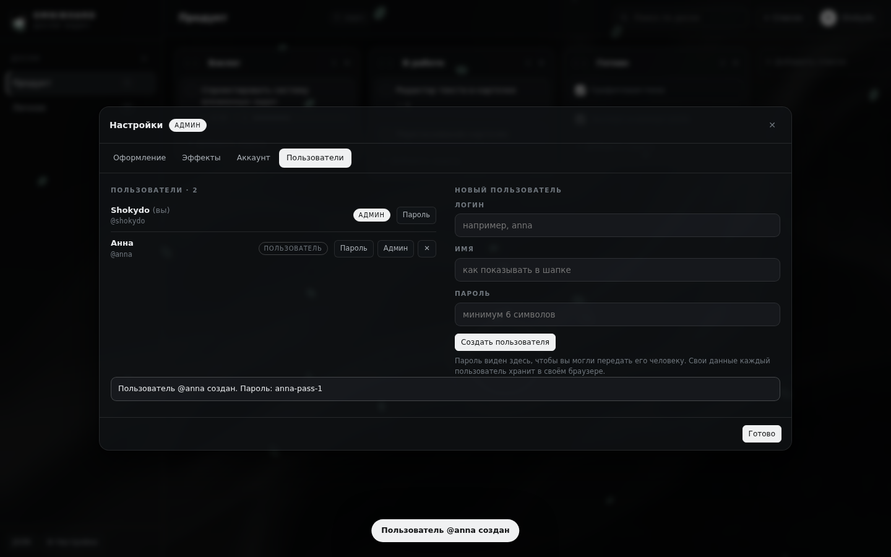
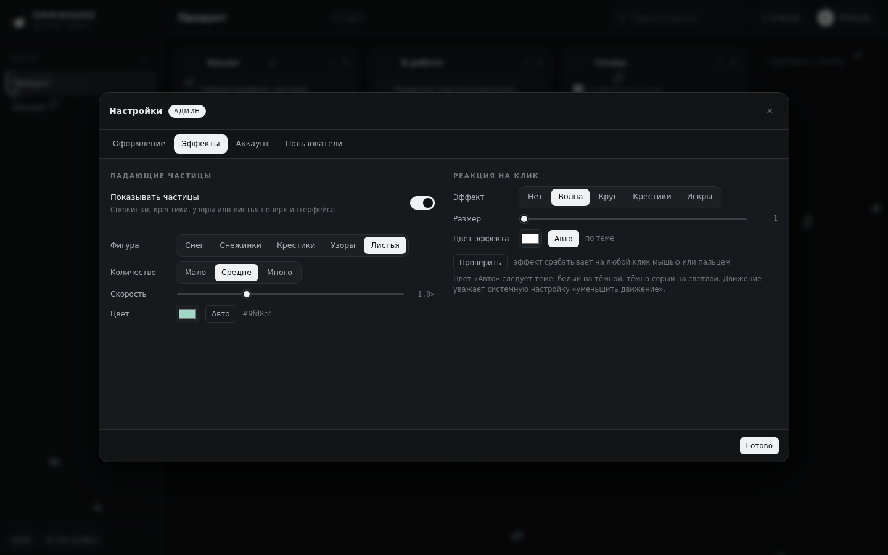
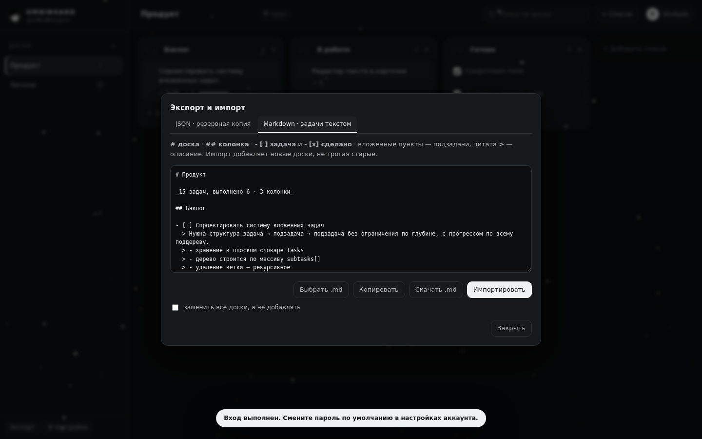
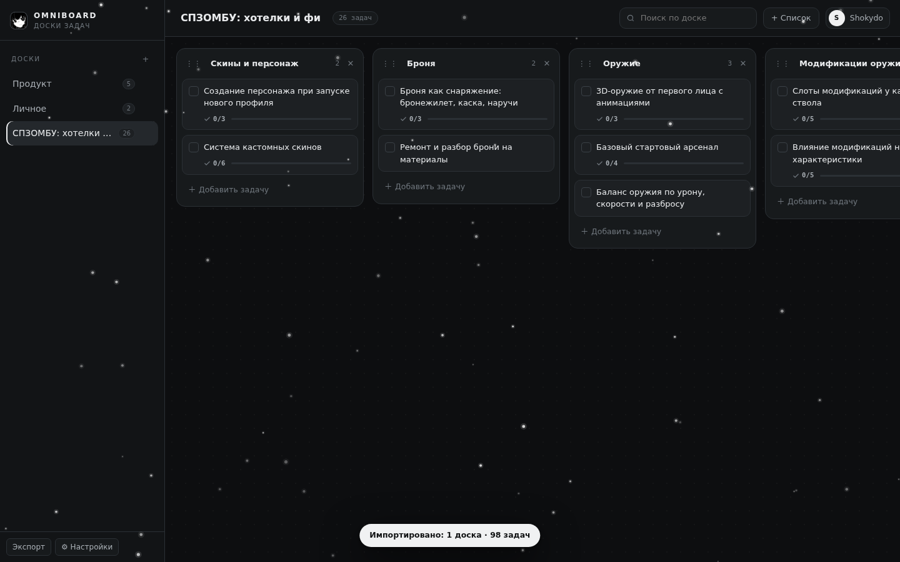
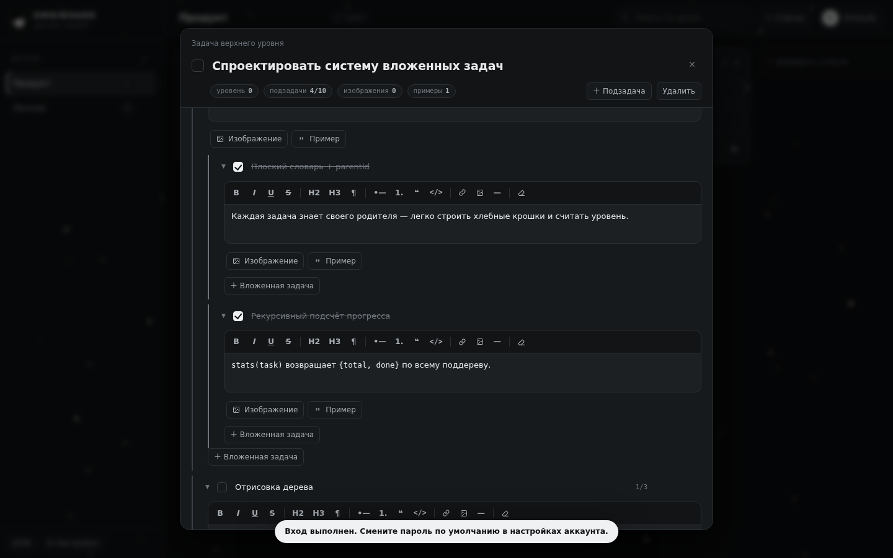
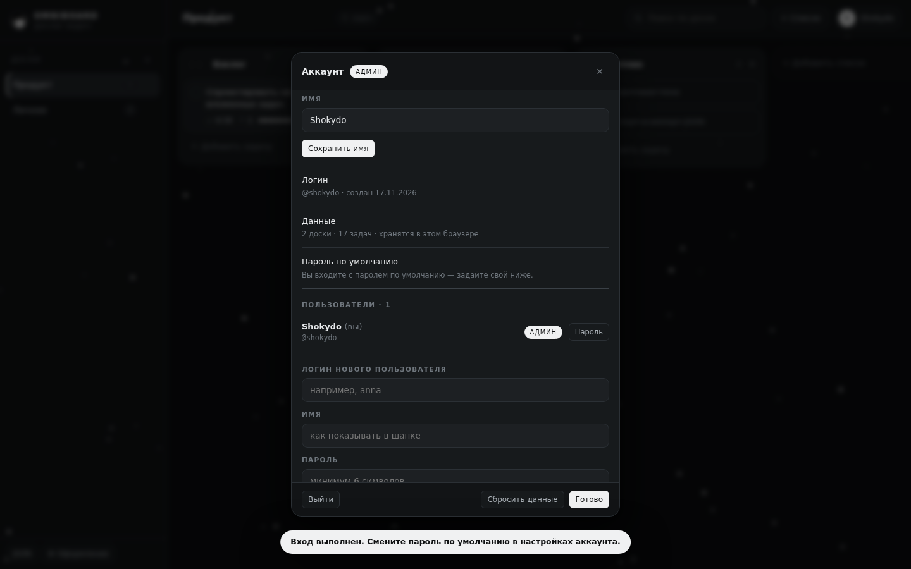

# OmniBoard

Канбан-доски для технических задач в одном HTML-файле: аккаунты с ролями, доски как в Trello, задачи любой вложенности, редактор текста, изображения, примеры, настраиваемый фон и эффекты — падающие частицы и реакция на клики. Без сервера, сборки и зависимостей.

**[Открыть демо](https://shokydo.github.io/OmniBoard/)** · вход в аккаунт `Shokydo`, пароль по умолчанию `omniboard` (смените его в настройках аккаунта). Всё хранится в вашем браузере.


## Возможности

### Аккаунты и авторизация
- Только вход по логину и паролю, «запомнить меня» на устройстве — публичной регистрации нет.
- **Роли:** `администратор` и `пользователь`. Администратор создаёт аккаунты прямо в настройках, задаёт и сбрасывает пароли (без знания старого), выдаёт и снимает права, удаляет пользователей вместе с их данными. Себя удалить нельзя, последнего администратора нельзя разжаловать.
- Аккаунт `Shokydo` создаётся автоматически при первом открытии страницы; пароль по умолчанию — `omniboard`, в интерфейсе об этом есть напоминание, пока пароль не сменён.
- Пароль хранится как **PBKDF2-SHA256** (12 000 итераций, случайная соль 16 байт) — реализация без внешних библиотек, совпадает с эталоном WebCrypto.
- В настройках аккаунта: смена имени, смена пароля (с проверкой текущего и снятием флага «пароль по умолчанию»), выход, сброс данных аккаунта.
- Данные **изолированы по пользователю**: у каждого свои доски, задачи и оформление.
- Всё локально: аккаунты и доски лежат в `localStorage` браузера. Забытый пароль восстановить нельзя — для переноса есть экспорт JSON.

> Честное предупреждение: это клиентская авторизация для локального приложения. Она защищает от случайного доступа и разделяет профили, но не заменяет серверную аутентификацию — любой, у кого есть доступ к браузеру и devtools, может прочитать данные.

### Доски и задачи
- Несколько досок, колонки: создание, переименование, удаление, перестановка за ручку `⋮⋮`.
- Карточки перетаскиваются между колонками и внутри колонки (pointer-события, живой «призрак», подсветка места вставки, поддержка тач-устройств по долгому нажатию).
- Поиск по доске (`Ctrl/Cmd+K`).
- **Сворачиваемое меню:** кнопка `‹` в шапке сайдбара убирает его за край экрана, доска занимает всю ширину, вернуть меню можно гамбургером в верхней панели. Состояние запоминается в профиле и не сбрасывается при обновлении страницы; на узких экранах (≤900 px) сайдбар по-прежнему выезжает поверх доски по гамбургеру.
- **Панорамирование доски:** зажмите ЛКМ на свободном месте доски и тяните влево-вправо — колонки плавно едут за курсором (курсор меняется на «лапу», текст не выделяется). Старт с карточки, кнопки или поля ввода оставлен для обычных действий, на тач-устройствах работает нативный скролл.
- Вложенность без ограничения: **задача → подзадача → подзадача → …**, прогресс по всему поддереву, хлебные крошки, открытие подзадачи отдельной карточкой.
- Клавиатура по дереву: `Enter` — подзадача рядом, `Tab` — вложить, `Shift+Tab` — вынести выше, `Backspace` в пустом названии — удалить.
- Чекбоксы на карточках и на любом узле дерева.
- Редактор текста: B/I/U/S, H2/H3, списки, цитата, блок кода, ссылка, разделитель, картинка в тексте, вставка из буфера `Ctrl+V`.
- Изображения: файлами, перетаскиванием или из буфера; галерея с просмотром на весь экран.
- Примеры: блоки «заметка / код» с названием и текстом, счётчики на карточке.
- Экспорт/импорт JSON (включая настройки оформления) и **Markdown**, автосохранение.





Панорамирование зажатой мышью:



### Импорт и экспорт Markdown
Задачи можно вести текстом и забирать обратно — без ручного перещёлкивания.

```markdown
# Доска

## Колонка

- [ ] Задача
  > описание задачи
  - [x] подзадача выполнена
    - [ ] подзадача третьего уровня
- [x] Готовая задача
```

- `#` — доска, `##` — колонка, `- [ ]` / `- [x]` — задача и её статус, вложенные пункты — подзадачи любой глубины.
- `>` — описание задачи, блок кода ``` ``` — пример в карточке, строка `> пример: Название` задаёт заголовок примера.
- Импорт по умолчанию **добавляет** доски, галочка «заменить все доски» — перезаписывает.
- Экспорт отдаёт все доски одним файлом с шапкой (сколько задач, сколько выполнено) и сохраняется кнопкой «Скачать .md».
- Круговой рейс проверен: экспорт → импорт → экспорт даёт побайтово тот же текст.
- В репозитории лежит готовый пример — [`samples/spzombu-wishlist.md`](samples/spzombu-wishlist.md): 10 колонок, ~98 задач с вложенностью до 4 уровней.

### Настройки и оформление (сохраняется в профиле пользователя)
Одна панель «Настройки» с вкладками **Оформление · Эффекты · Аккаунт · Пользователи** — профиль, пароль и оформление больше не разбросаны по разным окнам.

- Тема: тёмная графитовая и светлая, интерфейс — только чёрный/белый/серая шкала.
- Фон: **графит**, **цвет**, **градиент** (два цвета + наклон) или **картинка**.
- Для картинки: загрузка файлом или перетаскиванием, **затемнение 0–90 %** и **размытие 0–30 px**; панели интерфейса становятся «стеклянными» (`backdrop-filter`), чтобы фото читалось как фон, а не мешало.
- Настройки хранятся отдельно для каждого аккаунта: `omniboard.prefs.<id>`.

### Эффекты
- **Падающие частицы** на `<canvas>`: снег, снежинки с шестью лучами, крестики, узоры (ромб, астериск, треугольник, рамка) и листья. Включение, три уровня количества, скорость 0.4–2.4× и свой цвет; «Авто» следует теме, чтобы не спорить с графитом.
- **Реакция на клик**: волна, круг, разлетающиеся крестики или искры — с цветом и размером; есть кнопка «Проверить».
- Анимация засыпает в неактивной вкладке и уважает `prefers-reduced-motion`.

<table>
<tr>
<td></td>
<td></td>
</tr>
<tr>
<td></td>
<td></td>
</tr>
<tr>
<td></td>
<td></td>
</tr>
<tr>
<td></td>
<td></td>
</tr>
<tr>
<td></td>
<td></td>
</tr>
</table>

## Как запустить

**Просто открыть файл.** Скачайте `index.html` и откройте в браузере — работает офлайн, данные сохраняются в браузере.

**Локальный сервер** (если нужен «настоящий» origin для хранилища):

```bash
python3 -m http.server 8080
# затем http://localhost:8080/
```

**GitHub Pages.** Репозиторий уже настроен: Settings → Pages → Source: `main` / root. Страница будет по адресу `https://<username>.github.io/OmniBoard/`.

## Горячие клавиши

| Клавиши | Действие |
| --- | --- |
| `Enter` | новая подзадача рядом (в поле названия подзадачи) |
| `Tab` / `Shift+Tab` | вложить / вынести подзадачу |
| `Ctrl/Cmd+K` | поиск по доске |
| `Esc` | закрыть окно, панель или диалог |
| `Ctrl+V` | вставить изображение в текст |

## Структура

```
index.html      — всё приложение: разметка, стили, логика (~150 КБ, без зависимостей)
assets/         — иконка (icon-512.png, favicon.ico, avatar-128.png) и графитовые обои
                  для демонстрации фона
samples/        — пример Markdown со списком задач для импорта
screenshots/    — скриншоты для README
```

Ключи в `localStorage`:

| Ключ | Что хранит |
| --- | --- |
| `omniboard.auth.v1` | аккаунты: логин, имя, роль, соль, PBKDF2-хеш, параметры |
| `omniboard.session.v1` | активная сессия («запомнить меня» → localStorage, иначе sessionStorage) |
| `omniboard.data.<id>` | доски, колонки, задачи, подзадачи, изображения, примеры |
| `omniboard.prefs.<id>` | тема, фон, затемнение/размытие, частицы (тип, количество, скорость, цвет), эффект клика, свёрнутость левого меню (`ui.sidebarCollapsed`) |

## Технически

Один файл, ES5-совместимый JS без сборки и зависимостей. Модель — плоский словарь задач со ссылками `parentId` / `subtasks[]` плюс порядок карточек в колонках. Хеширование — собственная реализация SHA-256/HMAC/PBKDF2 (проверена на векторах NIST и сверена с `crypto.subtle`). Снег — `requestAnimationFrame` + `<canvas>` с DPR-масштабированием. Перетаскивание — pointer-события вместо HTML5 DnD: работает стабильнее и поддерживает тач.

Иконка: рисунок сжат в квадрат 512×512 и скруглён по углам, из него собраны `assets/favicon.ico` (16–256 px) и PNG-наборы; в `index.html` favicon и логотип встроены как `data:`-URI, поэтому один файл остаётся самодостаточным. Эффекты и частицы — один `<canvas>` с общим циклом `requestAnimationFrame`.

Панорамирование и сворачивание меню: `.board` слушает `pointerdown/pointermove/pointerup` с `setPointerCapture`, тянет `scrollLeft` на дельту курсора и не запускается на `touch` (там нативный скролл) и на интерактивных элементах. Свёрнутость — класс `side-collapsed` на `<body>` плюс `margin-left:-264px` у сайдбара в медиазапросе `min-width:901px`; значение живёт в `prefs.ui` и применяется до первого кадра, поэтому при загрузке меню не «уезжает».

Проверено автотестами на Chromium (102 шага в семи наборах): отсутствие регистрации в интерфейсе, вход с паролем по умолчанию, неверный пароль, смена пароля и имени, сброс данных аккаунта, создание пользователей администратором, изоляция данных, сброс чужого пароля, выдача и снятие прав, удаление пользователя, сохранение сессии, вкладки настроек, импорт и экспорт Markdown с проверкой кругового рейса, все пять фигур частиц (проверка пикселей канваса), цвет частиц и эффекта клика, появление и затухание кликов, миграция старых настроек, режимы фона, затемнение/размытие, вложенность задач, форматирование, изображения, drag & drop, сворачивание меню с сохранением после перезагрузки, панорамирование доски зажатой ЛКМ (в том числе что старт с карточки не двигает доску и не открывает редактор).
